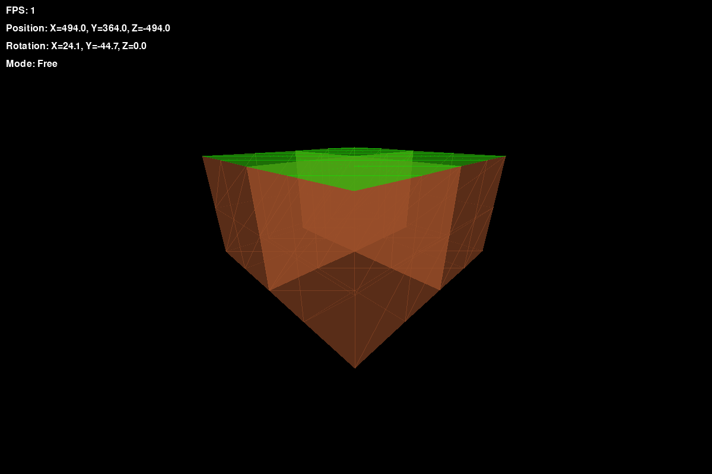

# triangle-hell

[中文](README.md) · [English](README.en.md) · [日本語](README.ja.md)

*Hand-rolled first-person 3D renderer. ~20k triangles per rebuild, no 3D engine.*
*The math is mine — so are the bugs.*

一个初中生写的 Python 3D 渲染器。没有 3D 引擎、没有 OpenGL、没有 Three.js ——
旋转矩阵、透视投影、近远裁剪、视锥剔除、画家算法排序，全部自己手写。
画布用 `pygame`，矩阵运算用 `numpy`。

## 两张图



`python/first-person/第一人称视觉10.py` 跑出来的画面。四个 300³ 的方块拼在一起，
中间那个十字缺口是四块正交的位置。相机初始位置在第一个 commit 里是 `(0,0,0)` ——
开局脸贴着方块，屏幕上只有一片褐色；现在挪到方块外面了，一眼能看见全貌。


`python/surface/花瓣.py`，17 行 numpy + matplotlib。一个参数曲面：

```python
r = a * (1 - u**2) * (1 + b*u)
x = r * np.cos(v) * (1 - k*u*np.sin(v/2))
z = r * np.sin(v) * (1 + k*u*np.cos(v))
y = u
```

同一个形状在不同参数下会从叶子翻成花瓣。

## 它每帧做四件事

1. **视图变换** —— 世界坐标减去相机位置，再乘旋转矩阵的**转置**
2. **透视投影** —— 屏幕高度和视场角算出焦距，除以深度得到缩放
3. **剔除** —— 近远裁剪 + 逐顶点视锥测试
4. **排序绘制** —— 按三角形重心深度从远到近画（画家算法）；半透明用 `temp_layer` 叠加

相机是 **Y-up**：`forward = R @ [0,0,1]`，`up = R @ [0,1,0]`，欧拉角顺序 `Ry · Rx · Rz`。

## 跑起来

```bash
pip install numpy pygame
python "python/first-person/第一人称视觉10.py"
```

（`花瓣.py` 还要 `matplotlib`：`pip install numpy matplotlib`，然后 `python "python/surface/花瓣.py"`。）

`WASD` 移动，鼠标转视角，`G` 切换游戏模式 / 自由模式。

单文件，339 行。游戏模式会把 `forward` 强制投影到水平面（人在走路），
自由模式是 6DOF 飞行。

## 几行数学

**透视投影** —— 屏幕高度和视场角决定焦距：

```python
SCALE = SCREEN_HEIGHT / (2 * np.tan(np.radians(FIELD_OF_VIEW / 2)))
x = point[0] * SCALE / depth + SCREEN_WIDTH / 2
y = SCREEN_HEIGHT / 2 - point[1] * SCALE / depth
```

**视图变换** —— 平移到相机原点，再乘旋转矩阵的转置：

```python
rotated = camera.rotation_matrix.T @ (point - camera.position)
```

**画家算法** —— 按三角形重心深度从远到近画：

```python
sorted(triangles, key=lambda t: t.center_z, reverse=True)
```

## 已知限制

这一版有两个简化：

- **没有真正的近平面裁剪**：`project()` 里任何一个顶点掉出近平面，整个三角形就被丢掉，
  而不是切开。所以贴近相机时会有三角形突然消失
- **排序按重心深度**，不是逐像素深度。两个三角形互相穿插时顺序会错（画家算法的老毛病）

> *The math is mine — so are the bugs.*

## License

MIT
