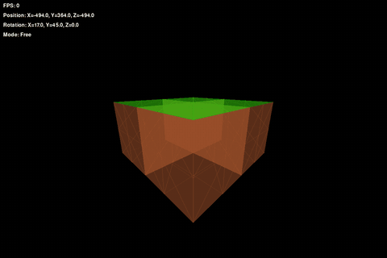
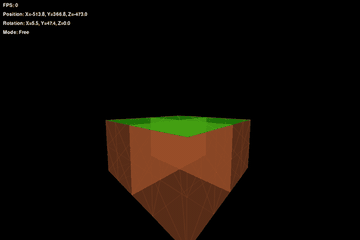

# triangle-hell

[English](README.md) · [中文](README.zh.md) · [日本語](README.ja.md)

*Hand-rolled first-person 3D renderer. ~20k triangles per rebuild, no 3D engine.*
*The math is mine — so are the bugs.*

A 3D renderer written in Python by a middle-school student. No 3D engine, no OpenGL,
no Three.js — view transforms, perspective projection, near/far clipping, frustum
culling and painter's-algorithm sorting are all written by hand.
Drawing is `pygame`; the matrix math is `numpy`.

## What it looks like



What `python/first-person/第一人称视觉10.py` actually renders. Four 300³ cubes butted
together — the cross-shaped notch in the middle is where all four meet.

One more piece, this one with no engine at all: `python/surface/花瓣.py`, 17 lines of
numpy + matplotlib that draw a single four-line parametric surface — a leaf that turns
into a petal as you nudge the parameters. Picture, formula and how to run it:
[`python/surface/README.md`](python/surface/README.md).

## What the renderer does every frame

1. **View transform** — subtract the camera position from world coordinates, then
   multiply by the **transpose** of the rotation matrix
2. **Perspective projection** — screen height and field of view give the focal length;
   divide by depth for the scale
3. **Culling** — near/far clipping plus a per-vertex frustum test
4. **Sort and draw** — sort triangles by centroid depth, far to near
   (painter's algorithm); translucency is layered through `temp_layer`

The camera is **Y-up**: `forward = R @ [0,0,1]`, `up = R @ [0,1,0]`,
Euler order `Ry · Rx · Rz`.



## Run it

```bash
pip install numpy pygame
python "python/first-person/第一人称视觉10.py"
```

(`花瓣.py` also needs `matplotlib`: `pip install numpy matplotlib`, then
`python "python/surface/花瓣.py"`.)

`WASD` to move, mouse to look around, `G` to toggle game mode / free mode.

One file, 339 lines. Game mode projects `forward` onto the horizontal plane — you walk.
Free mode is 6-DOF flight.

## A few lines of math

**Perspective projection** — screen height and field of view set the focal length:

```python
SCALE = SCREEN_HEIGHT / (2 * np.tan(np.radians(FIELD_OF_VIEW / 2)))
x = point[0] * SCALE / depth + SCREEN_WIDTH / 2
y = SCREEN_HEIGHT / 2 - point[1] * SCALE / depth
```

**View transform** — move to the camera origin, then multiply by the transpose:

```python
rotated = camera.rotation_matrix.T @ (point - camera.position)
```

**Painter's algorithm** — draw far to near by centroid depth:

```python
sorted(triangles, key=lambda t: t.center_z, reverse=True)
```

## Known limitations

Two simplifications in this version:

- **No real near-plane clipping.** If any vertex falls outside the near plane,
  `project()` drops the whole triangle instead of splitting it — so triangles pop
  out of existence when the camera gets close
- **Sorting is by centroid depth**, not per-pixel. Interpenetrating triangles are
  drawn in the wrong order — the old painter's-algorithm problem

> *The math is mine — so are the bugs.*

What the AI assistant changed: [docs/provenance.md](docs/provenance.md)

## License

[MIT](LICENSE) © 2026 Xichun Guo
